# Assembler for Nano-119/120 microprocessor 

## How it works
This repository contains the source code for the assembler program for the self-contained processing system, which features an SPI interface and is supported by a Nano-119/120 CPU (developed at Universidad Autonoma Metropolitana), whose hardware description is in the following repository:

https://github.com/galaguna/Nano119-CPU-programmable-with-SPI

The assembler program generates machine code from source code written in assembly language (a text file, typically with `.asm` extension) and saves it in text format in a file with `.hex` extension. The assembler program is written in Python and uses the PLY (Python Lex-Yacc) package as the basis and support for lexical-syntactic analysis.

## Lexical Specification (Terminal Symbols)

The lexer is case-insensitive and ignores whitespace characters, tabs, commas, periods, and colons (‘ \t,.:’). Recognized tokens are classified according to the following table:

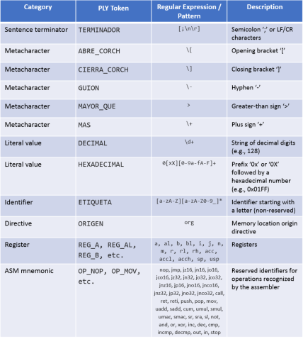

## Summary of Addressing Modes Associated with the MOV Mnemonic

The Nano-120 assembler syntax simplifies programming by using the generic `MOV` mnemonic, which groups all data transfer operations with various addressing modes, eliminating the need for the programmer to use the specific mnemonics associated with the opcodes of each instruction type. The following table summarizes the different addressing modes supported by the generic `MOV` mnemonic:

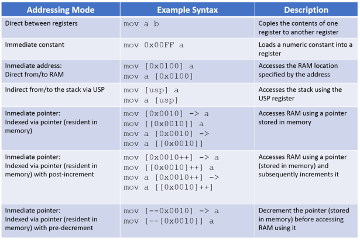

Of interest is the assembler’s flexibility in representing instructions with an immediate pointer. There are two valid syntactic ways to express an immediate pointer (a pointer located in a RAM memory location whose ADD address is an immediate argument within the machine code):

a) Using implicit notation: `[ADD]->`

b) Using explicit notation: `[[ADD]]`

For example, line 12 of the following code uses implicit notation:

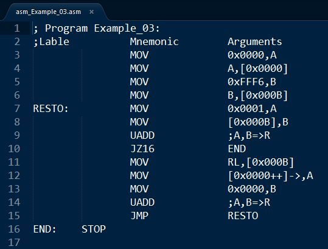

Whereas in line 12 of the following code, explicit notation is used:

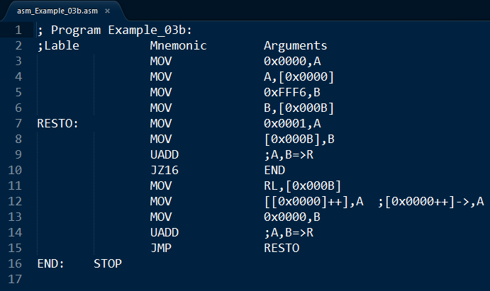

The variants of the post-increment syntax are as follows:

a) Using implicit notation: `[ADD++]->`

b) Using explicit notation: `[[ADD]++]`

Meanwhile, the syntax variants for post-increment are as follows:

a) Using implicit notation: `[--ADD]->`

b) Using explicit notation: `[--[ADD]]`

## Formal Syntactic Grammar with EBNF Notation

The following is the formal specification of the production rules that govern the syntax of the assembly language for the microprocessor supported by an Enhanced Post’s Machine (EPM):

/* Main Program Structure */

`<programa>        ::= <linea>*`

`<linea>           ::= [ <linea_asm> ] TERMINADOR`

`<linea_asm>       ::= <directiva_org> | <sentencia>`

`<sentencia>       ::= [ ETIQUETA ] <instruccion>`

/* Origin Directive and Operands */

`<directiva_org>   ::= "org" <numero>`

`<numero>          ::= DECIMAL | HEXADECIMAL`

`<destino_salto>   ::= ETIQUETA | <numero>`

/* Instruction Categories */

`<instruccion>     ::= <inst_noarg>`
                    `| <inst_add>`
                    | <inst_push>
                    | <inst_pop>
                    | <inst_not>
                    | <inst_inc>
                    | <inst_dec>
                    | <inst_cmp>
                    | <inst_xcmp>
                    | <inst_in>
                    | <inst_out>
                    | <inst_mov>`

/* 1. Instructions Without Arguments */

`<inst_noarg>   ::= "nop" | "ret" | "reti" | "uadd" | "sadd" | "cum" 
                 | "umul" | "smul" | "umac" | "smac" | "sr" | "sra" 
                 | "sl" | "and" | "or" | "xor" | "stop"`

/* 2. Jump Instructions and Subroutine Calls (Require an Address or Label) */

`<inst_add>     ::= <op_salto> <destino_salto>`

`<op_salto>     ::= "jmp" | "jz16" | "jn16" | "jo16" | "jco16" 
                 | "jz32" | "jn32" | "jo32" | "jco32" 
                 | "jnz16" | "jp16" | "jno16" | "jnco16" 
                 | "jnz32" | "jp32" | "jno32" | "jnco32" | "call"`

/* 3. Operations with Stack and Registers */

`<inst_push>    ::= "push" ( "a" | "b" | "i" | "j" | "n" | "m" )`

`<inst_pop>     ::= "pop"  ( "a" | "b" | "i" | "j" | "n" | "m" )`

`<inst_not>     ::= "not"  ( "a" | "b" )`

`<inst_inc>     ::= "inc"  ( "usp" | "i" | "j" )`

`<inst_dec>     ::= "dec"  ( "usp" | "i" | "j" )`

`<inst_cmp>     ::= "cmp"  ( "i" | "j" )`

`<inst_xcmp>    ::= ( "incmp" | "decmp" ) "[" <numero> "]"`

/* 4. Input/Output (I/O) */

`<inst_in>      ::= "in"  "[" <numero> "]"`

`<inst_out>     ::= "out" "[" <numero> "]" 
                 | "out" <numero> "[" <numero> "]"`

/* 5. Data Transfer (MOV) */

`<inst_mov>        ::= "mov" <op_mov_origen>`

`<op_mov_origen>   ::= "a" <mov_desde_a>
                    | "al" "usp"
                    | "b" <mov_desde_b>
                    | "bl" "usp"
                    | "r" "acc"
                    | "rl" <mov_desde_rl>
                    | "rh" <mov_desde_rh>
                    | "accl" <reg_ab>
                    | "acch" <reg_ab>
                    | "i" "a"
                    | "j" "a"
                    | "sp" ( "usp" | "a" | "b" )
                    | "usp" <reg_ab>
                    | <numero> <mov_desde_k>
                    | <memoria_fuente> <reg_ab>`

`<reg_ab>          ::= "a" | "b"`

`<mov_desde_a>     ::= "b" | "accl" | "acch" | <memoria_destino>`

`<mov_desde_b>     ::= "a" | "accl" | "acch" | <memoria_destino>`

`<mov_desde_rl>    ::= "a" | "b" | "usp" | <memoria_destino>`

`<mov_desde_rh>    ::= "a" | "b" | <memoria_destino>`

`<mov_desde_k>     ::= "usp" | "a" | "b" | "i" | "j" | "n" | "m"`

`<memoria_destino> ::= "[" "usp" "]"
                    | "[" <numero> "]"
                    | "[" <numero> "]->"
                    | "[" "[" <numero> "]" "]"
                    | "[" <numero> "++" "]" "->"
                    | "[" "[" <numero> "++" "]" "]"`

`<memoria_fuente>  ::= "[" "usp" "]"
                    | "[" <numero> "]"
                    | "[" <numero> "]->"
                    | "[" "[" <numero> "]" "]"
                    | "[" <numero> "++" "]" "->"
                    | "[" "[" <numero> "++" "]" "]"
                    | "[" "--" <numero> "]->"
                    | "[" "--" "[" <numero> "]" "]"`

## How to test

Using the assembler program is very simple; just run the `Nano120_assembler.py` file in an environment that supports Python 3. Within the program, in the `main` section, the `Nano120_asm2hex()` function is called, with the name of the source code file as its argument, as shown in Figure 2.4. For example, if you want to assemble the assembly code in the file `Post_code.asm`, you can leave this name as is or replace it with the name of the corresponding file. In either case, if the source code has no syntax errors, a file with `.hex` extension will be generated, containing the machine code that can be programmed into the microprocessor’s code space.

The following figure shows a simple example of assembly language code:

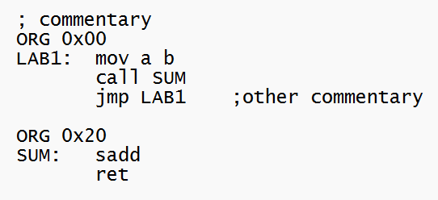

In this figure, you can see that the structure of an assembly program consists primarily of the following elements:

1. Comments, which always begin with the ‘;’ character.

2. The `ORG` directive (origin mnemonic), which specifies to the assembler the location where the machine code begins.

3. Labels, which are user-defined alphanumeric labels used to identify the locations where the machine codes (opcodes) of the subsequent instructions are stored.

4. The arguments, if any, of the instructions.

To load the executable program onto the processing system supported by a Nano-119/120 microprocessor, use the programming system whose software and firmware are in the following repository:

https://github.com/galaguna/NanoCPU_Programming_Tools

## Machine codification of Instruction set

All instructions are conveniently codified with bytes. The following tables summarizes the proposed instruction codification:

#### Key to the used notation 

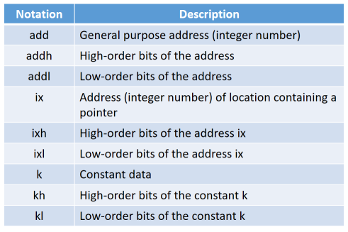

#### Flow control instructions

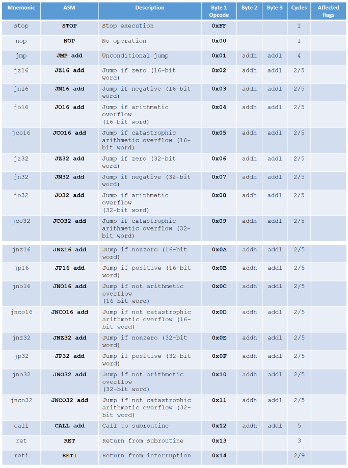

#### Stack instructions

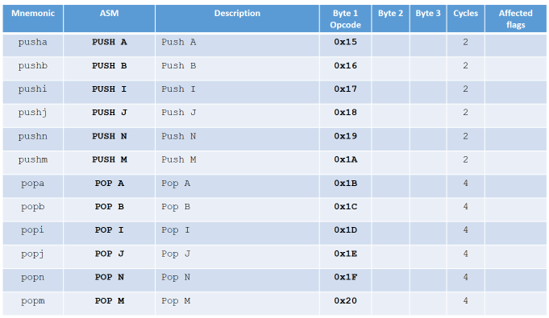

#### Instructions for moving between registers

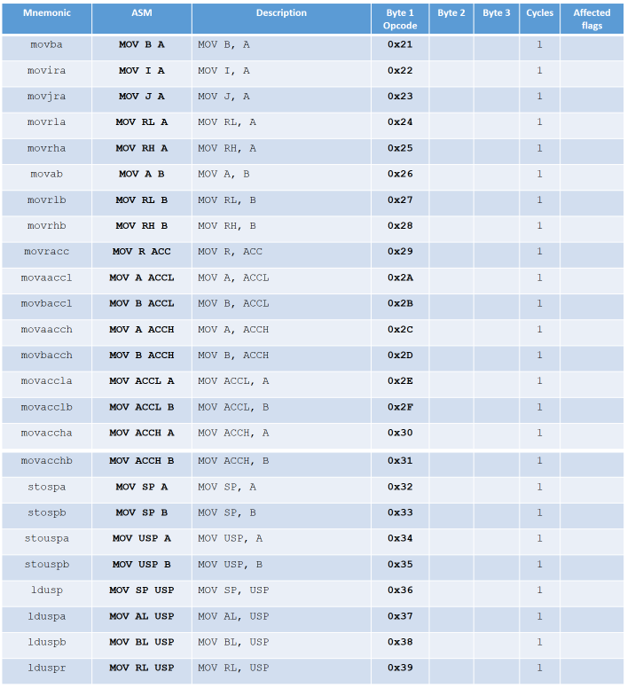

#### Immediate constant assignment instructions

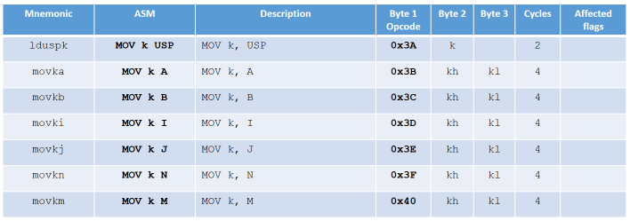

#### Instructions for moving data to/from memory using immediate addressing

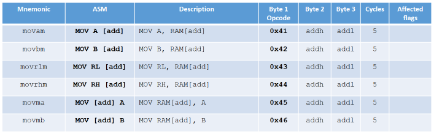

#### Instructions for moving data to/from memory using immediate pointer

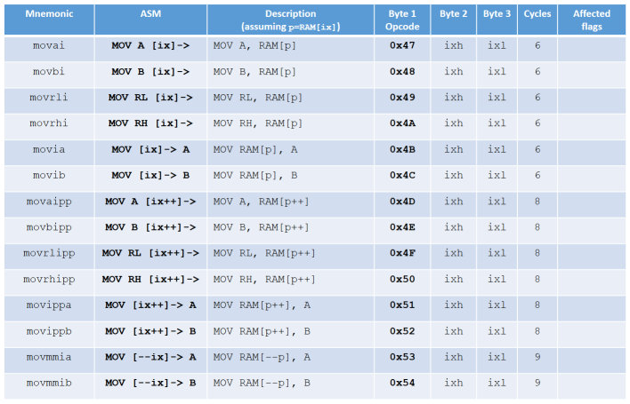

#### Instructions for moving data to/from stack space using indirect addressing

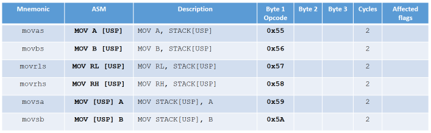

#### Arithmetic and logical instructions

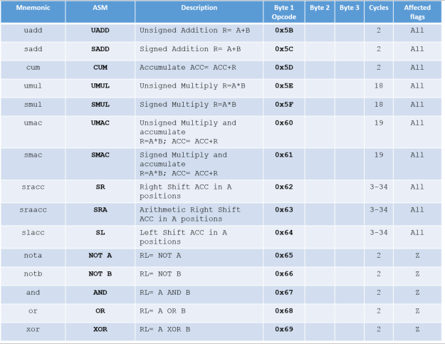

#### Increment/decrement and comparison instructions

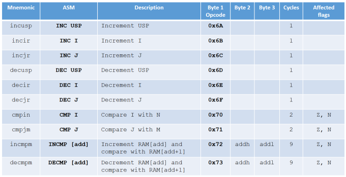

#### IO instructions

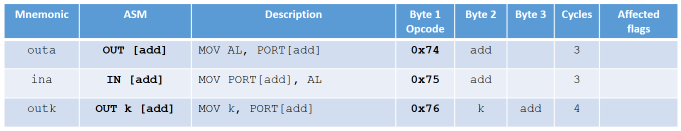

## How to cite

If you mention this project in a publication, I ask that you include the following citation for it

Laguna-Sanchez, G.A. (2026). Assembler for Nano-119/120 microprocessor.  
https://github.com/galaguna/NanoCPU_Assembler

